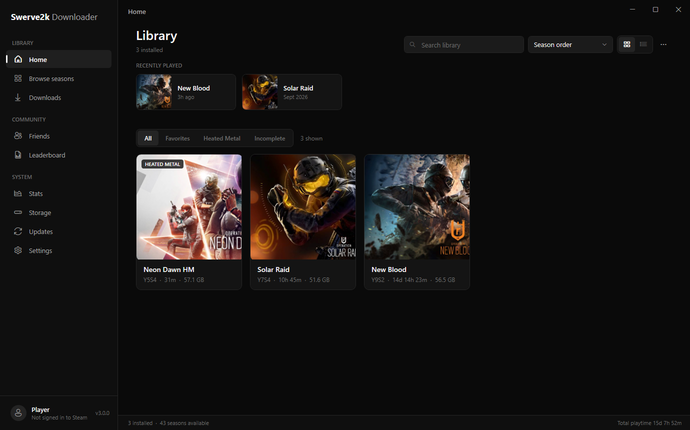
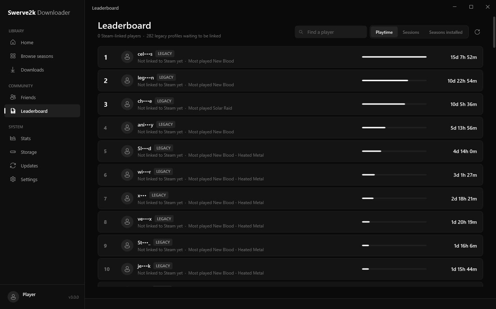
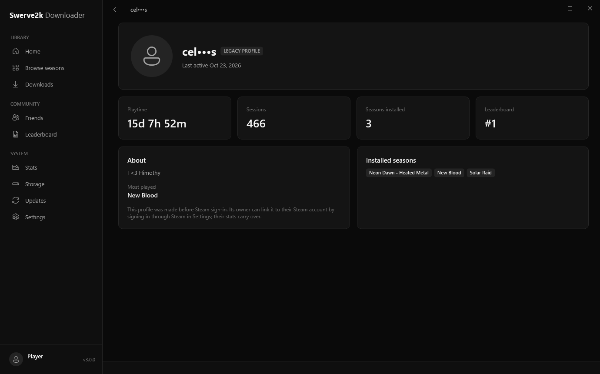

# Swerve2k Downloader

A launcher for **Rainbow Six Siege Operation Throwback**: download, manage and play older seasons of Siege from one app.

[](https://github.com/Swerve2k/R6ThrowbackLauncher/releases/latest)




## Download

1. Go to the [latest release](https://github.com/Swerve2k/R6ThrowbackLauncher/releases/latest).
2. Download `OperationThrowback_Setup_vX.Y.Z.exe` and run it.
3. Open **Swerve2k Downloader**, pick a season and press **Download**.

You need a Steam account that owns Rainbow Six Siege. Your password only goes to Steam.

Coming from 2.x? Run the new installer over your current one. Your seasons, settings and playtime are kept. From 3.0 on, the launcher updates itself.

## Features

**Seasons**
- Every season from Y1S0 to Y11S2, plus Heated Metal builds
- Season pages with release date, new operators, maps, events and requirements
- Renderer choice, launch options, per-season in-game name, notes and a game settings editor
- Library with favorites, filters, grid and list views, and recently played

**Downloads**
- One-click downloads straight from Steam
- Queue with pause, resume, reordering and cancel
- Multiple library folders, free space checks and file verification
- Free up space by removing intro videos, event data or high-resolution textures

**Community**
- Sign in through Steam: your profile and stats belong to your Steam account
- Friends, friend requests and chat
- Leaderboard by playtime, sessions and seasons installed; click any player to see their profile
- Live count of players online, Discord activity and an in-game overlay (Shift + F2)

**Updates**
- Update banner, popup and one-click install with a progress screen
- Announcements from the developer show up when you open the launcher

| Leaderboard | Profile |
|---|---|
|  |  |

## Help

- [Operation Throwback FAQ](https://puppetino.github.io/Throwback-FAQ/Pages/getting_started.html)
- [Discord](https://discord.com/invite/r6s-operation-throwback-2-0-1092820800203141130)
- Found a bug? [Open an issue](https://github.com/Swerve2k/R6ThrowbackLauncher/issues).

## Building from source

The source is in [`R6ThrowbackLauncher/`](R6ThrowbackLauncher). It is a WPF app for .NET 8 (Windows only).

```powershell
cd R6ThrowbackLauncher
dotnet build -c Release
dotnet publish -c Release
# Installer (needs Inno Setup 6)
& "$env:LOCALAPPDATA\Programs\Inno Setup 6\ISCC.exe" OperationThrowback.iss
```

The third-party Heated Metal files are not in this repository. Builds without them work, but can't install Heated Metal seasons.

See [CHANGELOG.md](R6ThrowbackLauncher/CHANGELOG.md) for what changed in each version.

## Credits

- **SteamRE** - [DepotDownloader](https://github.com/SteamRE/DepotDownloader)
- **Lungu** - ThrowbackLoader
- **JVAV** - Hashes and `manifest.json`

<table>
<tr>
<td align="center"><a href="https://github.com/JOJOVAV"><br /><sub><b>JOJOVAV</b></sub></a></td>
<td align="center"><a href="https://github.com/lungu19"><br /><sub><b>lungu19</b></sub></a></td>
<td align="center"><a href="https://github.com/Vergepoland"><br /><sub><b>Vergepoland</b></sub></a></td>
</tr>
</table>

Made by **Swerve2k**. Not affiliated with, endorsed by or sponsored by Ubisoft or Valve.
